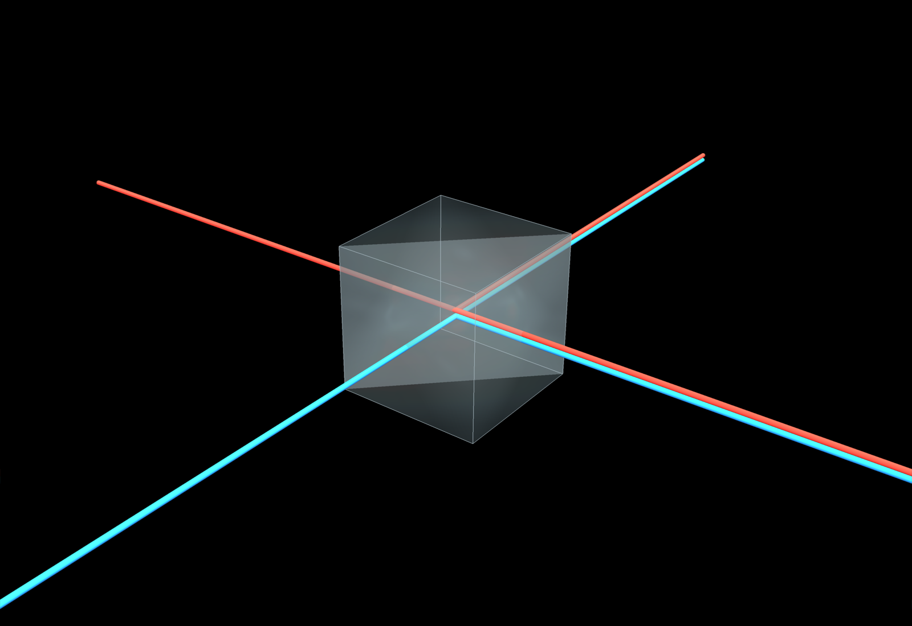

# HOM: The Quantum Effect of Light Passing Through a Window

> At light levels low enough to count single photons, we can see quantum interference on everyday windows.



This repository holds the article *The Quantum Effect of Light Passing Through a Window*, an introduction to the **Hong–Ou–Mandel (HOM) effect**, together with the Python scripts that generate every figure in it.

The article starts from something familiar, a pane of glass that partly reflects and partly transmits light, and follows it down to the single-photon level. There, a window acts as a 50/50 beamsplitter, and two identical photons arriving from opposite sides will never leave through different outputs.

**Read the article:** [robhendrik.github.io/HOM](https://robhendrik.github.io/HOM/) (or the Markdown source, [`Article.md`](Article.md))

## What the article covers

- **A window as a beamsplitter.** Why reflection from the two sides of the glass carries different phases (180° flip vs. none), and why energy conservation requires it.
- **A single photon at a window.** The photon's wave function follows the classical logic, and the probability of each output is the squared amplitude.
- **Two photons meeting.** The "both transmitted" and "both reflected" histories lead to the same final state with opposite signs and cancel, so one photon per output never happens.
- **Bosonic enhancement.** Where the √2 in `a†a†|0⟩ = √2|2⟩` comes from, and why the probability of both photons leaving through one given port is 50%, not 25%.
- **The HOM dip.** Delaying one photon relative to the other makes the photons distinguishable. The coincidence probability then rises from zero at perfect overlap to 1/2.
- **Distinguishability.** Time, polarization, frequency and spatial mode can all act as labels. The depth of the dip measures how completely two photons' quantum states overlap.
- **Why "bunching" is not attraction.** Photons do not interact; the effect comes from amplitudes that cancel and reinforce.
- **Why it matters.** HOM interference is used to verify photon indistinguishability and is a building block of photonic quantum information (Bell-state measurements, teleportation, entanglement swapping, optical quantum computing).

## Figures

| Figure | File | Shows |
| --- | --- | --- |
| Feature image | `feature_image.png` | A glass beamsplitter cube with red and blue input and output beams (rendered with PyVista) |
| Figure 1 | `HOM_figure1.png` | A single photon at a 50/50 beamsplitter. Both outputs have amplitude magnitude 1/√2, and one reflection carries a minus sign |
| Figure 2 | `HOM_figure2.png` | Two photons, two histories (both transmitted, both reflected), with amplitudes +1/2 and −1/2 that cancel |
| Figure 3 | `HOM_figure3.png` | Why two identical bosons in one mode give the √2 enhancement |
| Figure 4 | `HOM_figure4.png` | The Hong–Ou–Mandel dip: probability of one photon per output vs. relative arrival time |

## Repository contents

```
HOM/
├── Article.md                      # The article (Markdown source)
├── index.html                      # The article as a web page (served via GitHub Pages)
├── feature_image.png               # Feature image
├── HOM_figure1.png … figure4.png   # Figures used in the article
├── HOM_figure1_generator.py        # Scripts that regenerate each figure
├── HOM_figure2_generator.py
├── HOM_figure3_generator.py
├── HOM_figure4_generator.py
├── HOM_feature_image_generator.py  # PyVista render of the feature image
├── LICENSE
└── .gitignore
```

## Regenerating the figures

The figures are produced with Python.

**Requirements**

- Python 3
- `matplotlib` (figures 1–4)
- `numpy` (figure 4)
- `pyvista` and `vtk` (feature image only)

```bash
pip install matplotlib numpy pyvista vtk
```

**Run**

Every script begins with `os.chdir("HOM")`, so it expects to be launched from the directory that *contains* the repository folder, not from inside it. If you cloned the repo into a folder named `HOM`:

```bash
git clone https://github.com/robhendrik/HOM.git
cd HOM/..            # the parent of the cloned folder

python HOM/HOM_figure1_generator.py
python HOM/HOM_figure2_generator.py
python HOM/HOM_figure3_generator.py
python HOM/HOM_figure4_generator.py
python HOM/HOM_feature_image_generator.py
```

Each script writes its PNG into the `HOM` folder, overwriting the existing image. The figure scripts also open a matplotlib window (`plt.show()`), so on a headless machine set `MPLBACKEND=Agg`. The feature image renders off-screen at 1600 × 1100 with a fixed camera and lighting, so it is reproducible.

If you would rather run the scripts from inside the repo, remove the `os.chdir("HOM")` line from the script.

## Reference

C. K. Hong, Z. Y. Ou, and L. Mandel, "Measurement of subpicosecond time intervals between two photons by interference," *Physical Review Letters* **59**, 2044–2046 (1987).

## License

Released under the [MIT License](LICENSE). Copyright (c) 2026 Rob Hendriks.
